# Gestor de incidencias del aula · Trazabilidad HTTP y pruebas

- **Alumno/a:** María Ortega Cortés
- **Dirección local:** http://localhost:8081/login.php
- **Credenciales:** `aula` / `aula123`

## Índice

1. [Entorno de pruebas](#1-entorno-de-pruebas)
2. [Recorrido 1 · Acceso correcto](#2-recorrido-1--acceso-correcto)
3. [Recorrido 2 · Guardar una incidencia](#3-recorrido-2--guardar-una-incidencia)
4. [Recorrido 3 · Guardar el tamaño](#4-recorrido-3--guardar-el-tamaño)
5. [Pruebas](#5-pruebas)
6. [Conclusión](#6-conclusión)

---

## 1. Entorno de pruebas

La aplicación se ejecuta en Docker. Antes de probar se ha preparado el contenedor:

1. **Límites de PHP:** upload_max_filesize=100M y post_max_size=120M en un .ini de conf.d. Así PHP recibe archivos grandes y es la aplicación la que aplica su límite de 50 MiB.
2. **Permisos de uploads/:** `chown www-data:www-data` y `chmod 750`, para que Apache pueda guardar las imágenes.
3. **Herramientas:** pestaña **Red** (F12) con **Conservar registro** activado y pestaña **Aplicación** para ver las cookies.

---

## 2. Recorrido 1 · Acceso correcto

| #   | Solicitud del navegador                                                         | Procesamiento de PHP                                                                                            | Respuesta del servidor                                                                                  |
| --- | ------------------------------------------------------------------------------- | --------------------------------------------------------------------------------------------------------------- | ------------------------------------------------------------------------------------------------------- |
| 1   | `GET /login.php`                                                                | `session_start()`. No es POST, así que solo muestra el formulario.                                              | `200 OK` con el formulario. `Set-Cookie: UD04INCIDENCIAS=ID1` si no había sesión.                       |
| 2   | `POST /login.php` con `usuario` y `clave`. Envía `Cookie: UD04INCIDENCIAS=ID1`. | `trim` al usuario, `password_verify` correcto, `session_regenerate_id(true)` y `$_SESSION['usuario'] = 'aula'`. | `303 See Other`, `Location: incidencias.php` y `Set-Cookie: UD04INCIDENCIAS=ID2` (identificador nuevo). |
| 3   | `GET /incidencias.php` con `Cookie: UD04INCIDENCIAS=ID2`.                       | Encuentra `$_SESSION['usuario']` y muestra el listado.                                                          | `200 OK` con el listado.                                                                                |

**Explicación:** el identificador de sesión cambia en el paso 2 (de `ID1` a `ID2`). Lo hace `session_regenerate_id(true)` para evitar la fijación de sesión: un identificador conocido antes de iniciar sesión deja de servir.

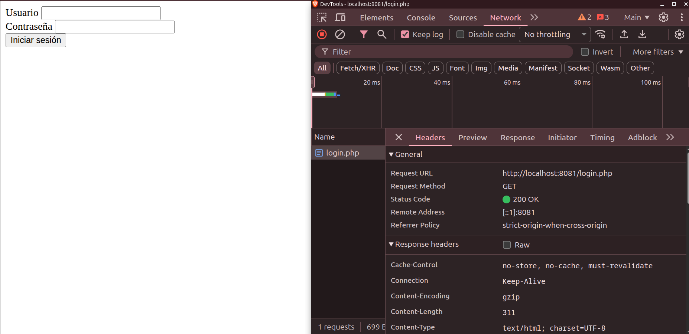

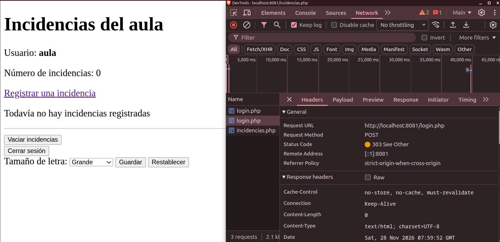

---

## 3. Recorrido 2 · Guardar una incidencia

| #   | Solicitud del navegador                                                      | Procesamiento de PHP                                                                                                           | Respuesta del servidor                         |
| --- | ---------------------------------------------------------------------------- | ------------------------------------------------------------------------------------------------------------------------------ | ---------------------------------------------- |
| 1   | `POST /nueva.php` con `Content-Type: multipart/form-data` (campos e imagen). | Valida los campos, comprueba la imagen con Fileinfo, la mueve a `uploads/` y añade la incidencia a `$_SESSION['incidencias']`. | `303 See Other` y `Location: incidencias.php`. |
| 2   | `GET /incidencias.php`                                                       | Lee `$_SESSION['incidencias']` y muestra la incidencia nueva.                                                                  | `200 OK` con el listado.                       |

**Por qué recargar no duplica la incidencia:** después del 303, la última petición del navegador es el `GET` del listado, no el `POST`. Al recargar se repite ese `GET`, que solo lee la sesión, y el formulario no se vuelve a enviar. Es el patrón **PRG** (Post/Redirect/Get).

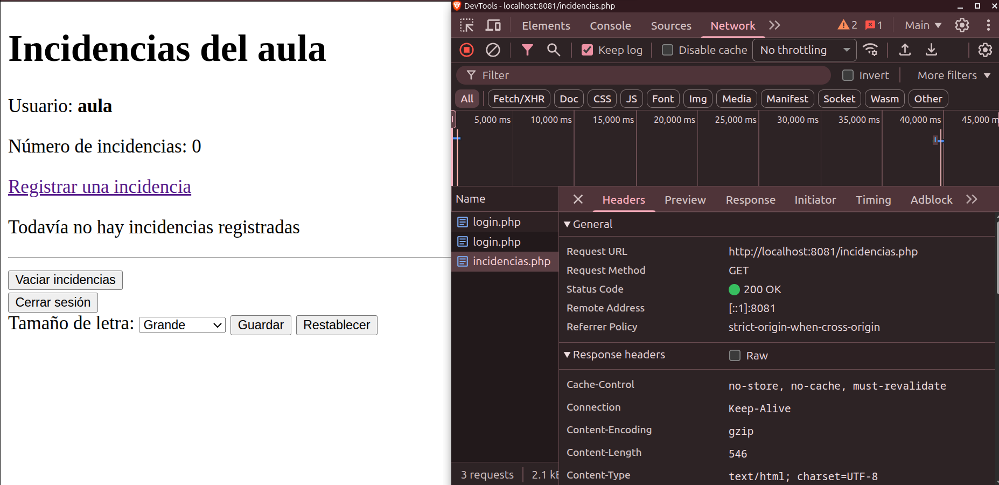

---

## 4. Recorrido 3 · Guardar el tamaño

| #   | Solicitud del navegador                                                                 | Procesamiento de PHP                                                | Respuesta del servidor                                                                                                        |
| --- | --------------------------------------------------------------------------------------- | ------------------------------------------------------------------- | ----------------------------------------------------------------------------------------------------------------------------- |
| 1   | `POST /preferencias.php` con `tamano=grande&accion=guardar`.                            | Comprueba que `grande` está en el catálogo y llama a `setcookie()`. | `303`, `Location: incidencias.php` y `Set-Cookie: ud04_incidencias_tamano=grande; expires=…; path=/; HttpOnly; SameSite=Lax`. |
| 2   | `GET /incidencias.php` con `Cookie: UD04INCIDENCIAS=…; ud04_incidencias_tamano=grande`. | Lee `$_COOKIE`, valida el valor y aplica `1.25rem`.                 | `200 OK` con la letra más grande.                                                                                             |

**Explicación:** la cookie se crea en la respuesta (`Set-Cookie`), pero PHP solo la ve en `$_COOKIE` en la **petición siguiente**, cuando el navegador la envía (`Cookie`).

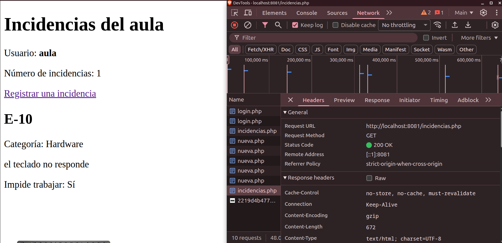

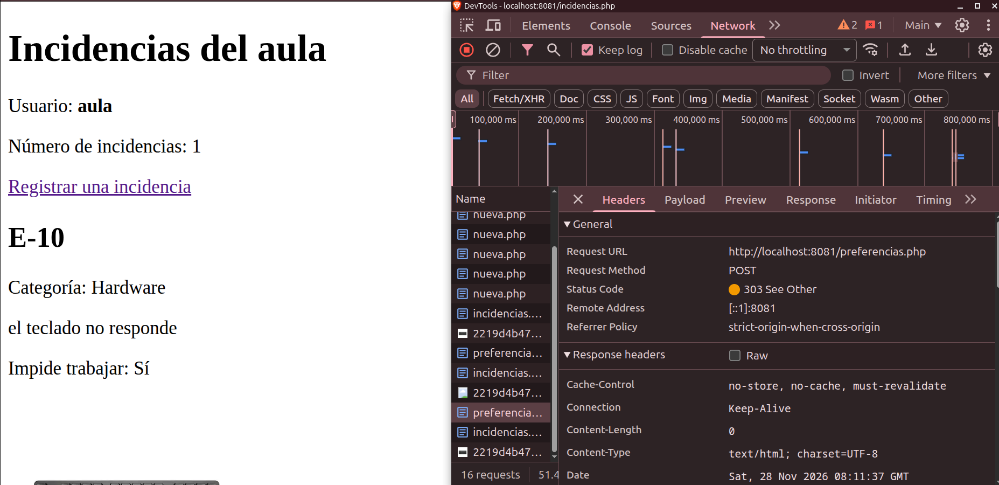

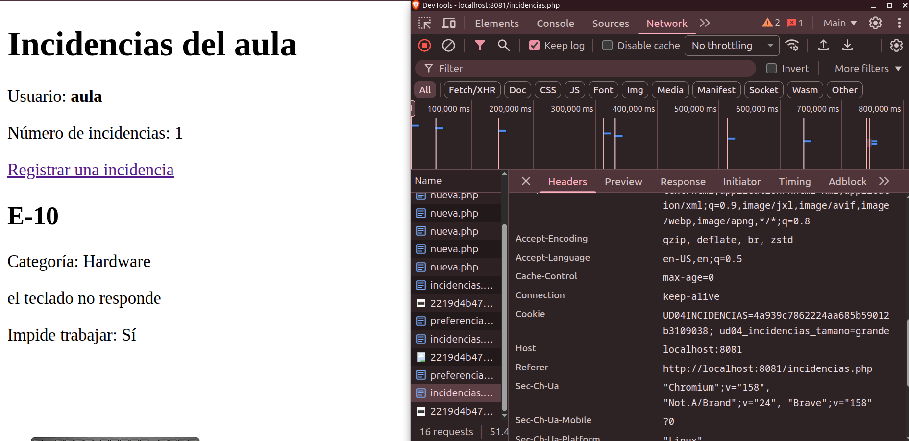

---

## 5. Pruebas

| Nº  | Prueba                                     | Resultado esperado                                          | Resultado obtenido                                                                                            |
| --- | ------------------------------------------ | ----------------------------------------------------------- | ------------------------------------------------------------------------------------------------------------- |
| 1   | Abrir `incidencias.php` sin iniciar sesión | Redirige a `login.php`                                      | Correcto: en Red aparece un 303 a `login.php` y se muestra el formulario de acceso.                           |
| 2   | Credenciales incorrectas                   | «Usuario o contraseña incorrectos» y se conserva el usuario | Correcto: con `aula` / `1234` sale el mensaje y el campo usuario sigue con `aula`.                            |
| 3   | Incidencia válida sin imagen               | Aparece en el listado sin imagen                            | Correcto: el número de incidencias pasa a 1 y se muestra sin imagen.                                          |
| 4   | Incidencia válida con imagen               | Aparece con la imagen                                       | Correcto: la imagen se guarda en `uploads/` con un nombre aleatorio y se ve en el listado.                    |
| 5   | Campos incorrectos                         | Mensajes de error y se conservan los valores y la casilla   | Correcto: sale un error en equipo y en descripción; se conservan el texto, la categoría y la casilla marcada. |
| 6   | Un `.txt` renombrado a `.png`              | «Solo se admiten imágenes JPEG o PNG» y no se registra      | Correcto: aparece el mensaje y el número de incidencias no cambia.                                            |
| 7   | Archivo de más de 50 MiB                   | «La imagen debe ocupar como máximo 50 MiB» y no se registra | Correcto: con un archivo de 60 MB aparece el mensaje y no se registra.                                        |
| 8   | Recargar el listado después de guardar     | No se duplica                                               | Correcto: tras F5 el número de incidencias sigue igual; se repite el GET, no el POST.                         |
| 9   | Cookie manipulada (`enorme`)               | Usa Normal                                                  | Correcto: la letra se ve en tamaño normal y el desplegable marca «Normal».                                    |
| 10  | Restablecer                                | Vuelve a Normal y se borra la cookie                        | Correcto: la letra vuelve a normal y la cookie desaparece de Aplicación.                                      |
| 11  | Vaciar                                     | 0 incidencias y se mantiene el acceso                       | Correcto: sale «Todavía no hay incidencias registradas» y sigue apareciendo el usuario `aula`.                |
| 12  | Cerrar sesión y abrir `incidencias.php`    | Redirige al login                                           | Correcto: después de cerrar sesión, `incidencias.php` lleva a `login.php`.                                    |
| 13  | Volver a entrar                            | Se conserva el tamaño, pero no las incidencias              | Correcto: la letra sigue en «Grande» y hay 0 incidencias.                                                     |
| 14  | Otra pestaña del mismo perfil              | Comparte la sesión                                          | Correcto: entra sin pedir login y muestra las mismas incidencias.                                             |
| 15  | Ventana de incógnito                       | Pide el login (sesión independiente)                        | Correcto: pide el login mientras la ventana normal sigue dentro.                                              |

### Capturas de las pruebas

**Prueba 2 · Credenciales incorrectas**

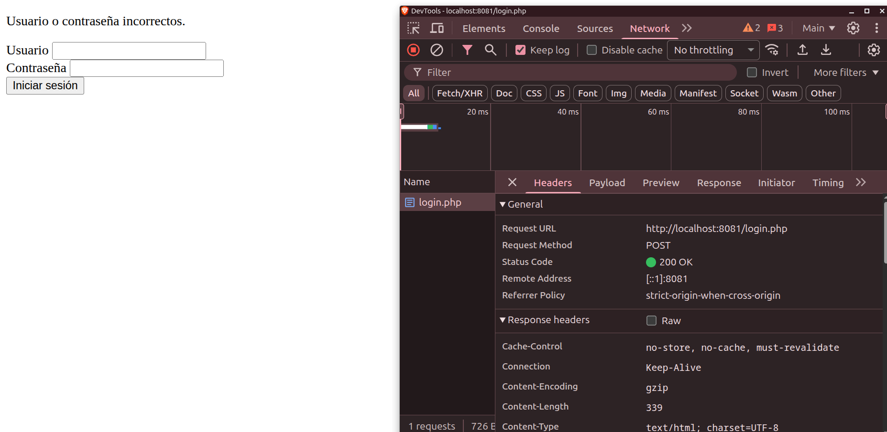

**Pruebas 3 y 4 · Listado con incidencias**

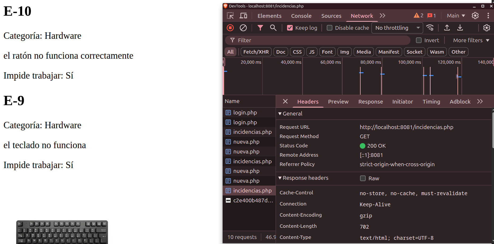

**Prueba 5 · Errores con valores conservados**

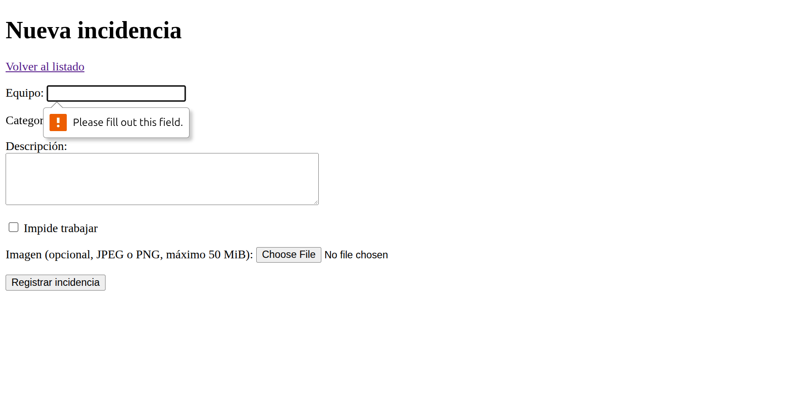

**Prueba 6 · Imagen rechazada**

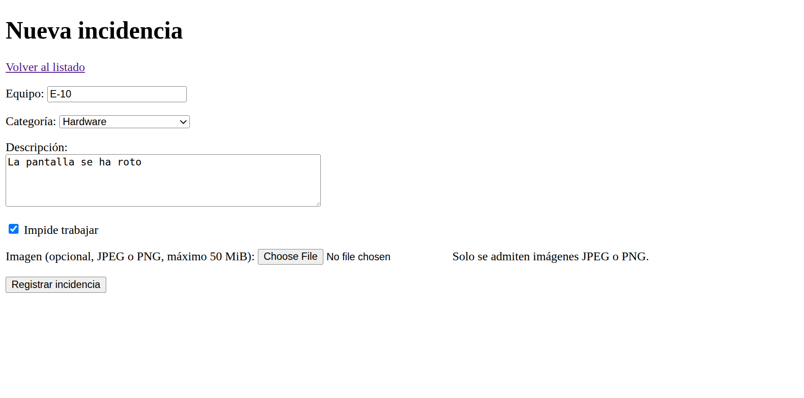

**Prueba 9 · Cookie manipulada**

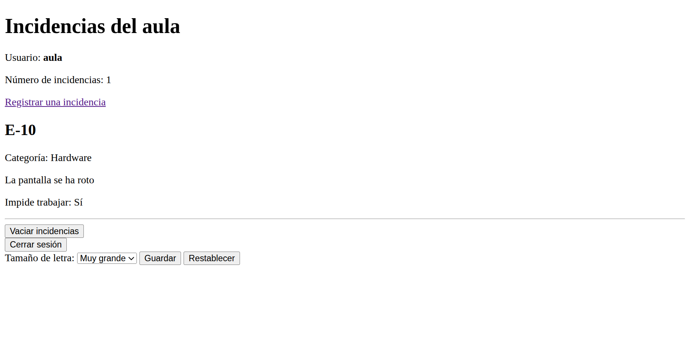

**Prueba 15 · Incógnito**

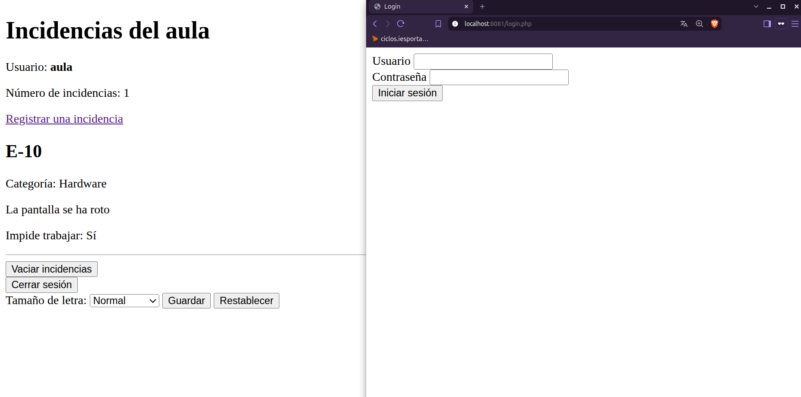

---

## 6. Conclusión

Todas las pruebas han dado el resultado esperado.
Durante el desarrollo encontré varios problemas.
El login no funcionaba porque el formulario enviaba los datos a incidencias.php y los campos no tenían name, así que $\_POST llegaba vacío.
Al subir imágenes, move_uploaded_file daba Permission denied porque la carpeta uploads/ no pertenecía al usuario de Apache; lo solucioné con chown www-data y chmod 750 dentro del contenedor.
Gracias a la comprobación del resultado de move_uploaded_file, la aplicación mostró un error y no registró la incidencia.
Por último, al cambiar el catálogo de tamaños a un array con texto y valor, tuve que acceder a $datos['texto'] en el desplegable y aplicar el tamaño en el <body> para que la cookie tuviera efecto.

Lo que más me ha ayudado a entender el proyecto ha sido la pestaña Red: ahí se ve que cada acción es un POST que responde con 303, que el identificador de sesión cambia al iniciar sesión y que una cookie creada con Set-Cookie solo llega a PHP en la petición siguiente.
